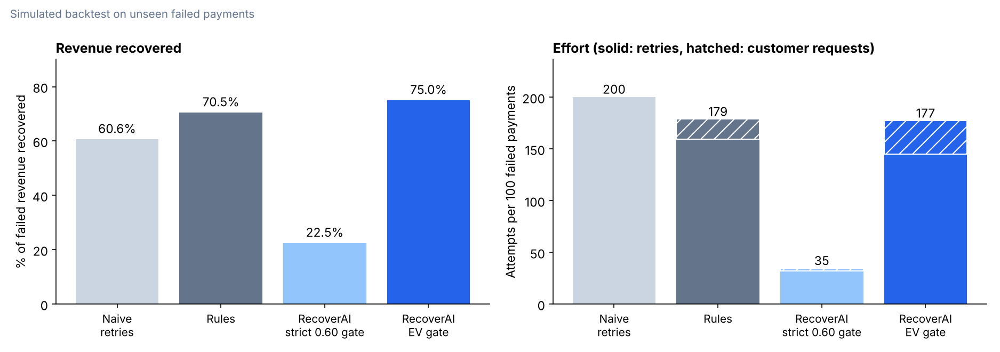
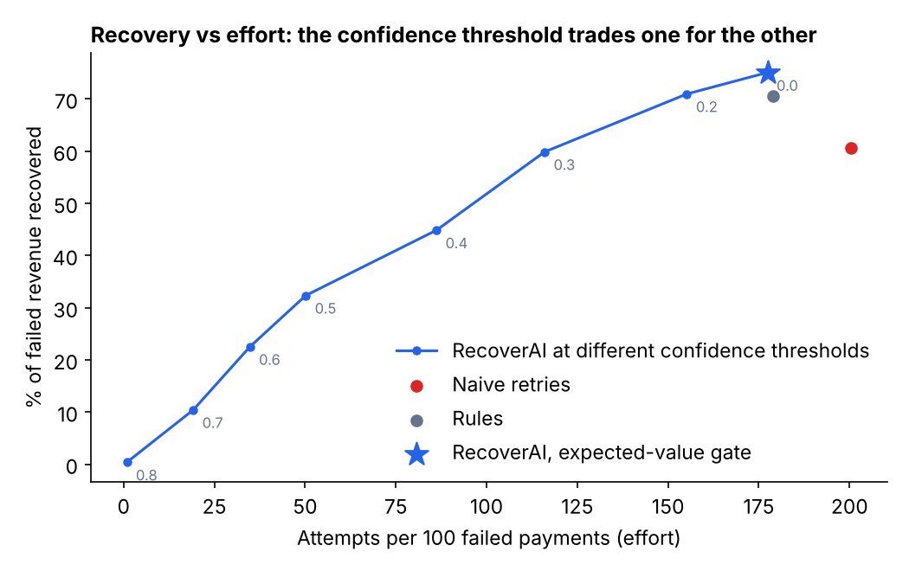
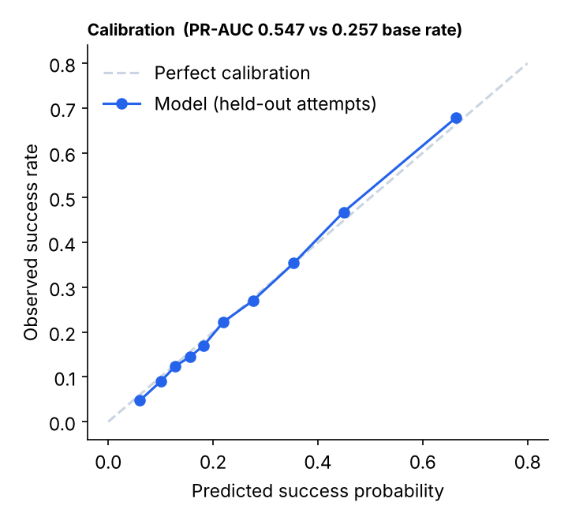

# RecoverAI — AI Revenue Recovery

RecoverAI watches failed payments, estimates how likely each recovery action is to work, picks the
action and timing with the best expected value, and acts inside merchant guardrails. It is a working
prototype: a FastAPI backend, a gradient-boosted model, a policy layer, an audit log and a dashboard.

> **Everything is simulated.** There is no real payment data. The model is trained on logged
> attempts from a simulated payments world (`backend/simulation.py`) and the results below show how
> the method behaves in that world, not how it would perform on real payments.

## Result: simulated backtest

Strategies were compared on 19,831 failed payments the model never saw (a later
time window than the training data), using the same random draws for every strategy so differences are
paired. Payments at or above the ₹1,00,000 approval limit (169 payments) are
excluded for every strategy because they need merchant approval. Each strategy gets up to 3 attempts.

| Strategy | Failed revenue recovered | Attempts per 100 payments | Customer requests per 100 | Revenue recovered per attempt |
| :--- | ---: | ---: | ---: | ---: |
| Naive: retry at 1h, 24h, 72h | 60.65% | 200.5 | 0.0 | ₹3,262 |
| Rules: retry timeouts and declines, ask the customer for expired cards and failed authentication | 70.5% | 178.9 | 19.6 | ₹4,249 |
| RecoverAI, strict 0.60 confidence gate | 22.5% | 34.8 | 2.7 | ₹6,964 |
| **RecoverAI, expected-value gate (default)** | 75.03% | 177.4 | 32.6 | ₹4,561 |



**What this shows**

- RecoverAI recovers **+14.4 percentage points** more than naive retries
  (95% interval 13.62 to 15.27) using
  23 fewer attempts per 100 payments.
- Against the stronger rules baseline the gain is smaller: **+4.5 points**
  (95% interval 4.01 to 5.06) with about the same effort. It gets there by timing retries
  well (for example waiting for the start of the month when funds were insufficient) and by choosing between retrying and asking the customer.
- **It asks customers more often** than the rules baseline (32.6 vs 19.6 requests per 100 payments). If customer contact is costly for a merchant, that is a real trade-off.

Recovered revenue by failure reason:

| Failure reason | Naive | Rules | RecoverAI |
| :--- | ---: | ---: | ---: |
| Network timeout | 90.4% | 90.4% | 90.1% |
| Gateway timeout | 87.3% | 87.3% | 87.1% |
| Bank declined | 65.6% | 65.6% | 69.1% |
| Insufficient funds | 42.9% | 42.9% | 53.0% |
| Authentication failed | 16.8% | 81.1% | 90.4% |
| Card expired | 3.9% | 84.1% | 91.4% |

### The confidence threshold finding

The first version used a 60% confidence floor. In this world a single retry of a bank decline or an
insufficient-funds failure succeeds only 20 to 45% of the time, so a 60% floor blocked most retries that
were still clearly worth attempting: it recovered only 22.5% of failed revenue.
The floor is now a configurable guardrail whose default was **chosen on a separate validation set** (not the test set):
the lowest-effort setting that matched the rules baseline's recovery. That setting was no floor, so the expected-value
check does the gating. The strict setting is still useful when attempts are expensive, because it has the best revenue per attempt (₹6,964):



### Model quality (held-out time window)

| Metric | Model | Reference |
| :--- | ---: | :--- |
| PR-AUC | 0.547 | 0.257 (always predict the base rate) |
| Brier score (lower is better) | 0.156 | 0.191 (base rate) |
| ROC-AUC | 0.762 | 0.765 (ceiling: the simulator's true probabilities) |

The model is well calibrated (predicted vs observed success rate below). It learns the patterns hidden in the
simulator, which is also why it performs close to the ceiling.



## How it works

1. **Detect:** failed payments arrive (seeded from the simulator, or created with "Simulate failed payment").
2. **Classify:** the failure reason, payment method, customer history and attempt number describe each case.
3. **Score:** the model estimates the success probability of every candidate action and timing: retry now or after 3, 12, 24, 48, 96 or 168 hours, ask the customer to update the payment method, or ask them to re-authenticate.
4. **Decide:** the best expected value (`probability x amount - cost of acting`) wins, then `backend/policy.py` decides whether it may run automatically.
5. **Act:** the action runs and its outcome is **sampled from the simulated world**, so recommendations can fail. A failed attempt keeps the payment open and uses up a retry.
6. **Audit:** every decision and outcome is written to the events table.

**Not implemented:** an online learning loop. The model is trained at startup from simulated logs; a real
deployment would retrain on real outcomes.

### Guardrails (`backend/policy.py`)

- Payments of ₹1,00,000 or more are never retried automatically; they wait for merchant approval.
- At most 3 automatic attempts per payment.
- Configurable confidence floor (default 0, see above) and an auto-recovery switch.
- An agent cycle acts on at most 20 payments, highest expected value first.

## Run it

```bash
pip install -r backend/requirements.txt
python -m uvicorn backend.main:app --reload --port 8000
```

Open http://localhost:8000. On first start the app seeds 5,000 simulated failed payments, trains the model
(a few seconds) and scores every payment.

```bash
pip install -r requirements-dev.txt
pytest                         # unit and behaviour tests
python -m backend.backtest     # regenerates reports/ (about 30 seconds)
```

## Project structure

| Path | Purpose |
| :--- | :--- |
| `backend/simulation.py` | The simulated world: failed payments, true success probabilities, logged attempts |
| `backend/ml_engine.py` | Model training and evaluation, candidate scoring, next-best action |
| `backend/policy.py` | Merchant guardrails |
| `backend/backtest.py` | Strategy comparison, threshold selection, charts |
| `backend/main.py` | FastAPI app: payments, metrics, events, agent cycle |
| `backend/db.py` | SQLite schema and demo data |
| `app.js`, `index.html`, `styles.css` | Dashboard |
| `reports/` | Backtest results and charts |
| `tests/` | pytest suite |

## Limitations

- **Simulated data and outcomes.** The world's rules are my assumptions (for example that expired cards never recover on retry and that salary timing matters). The model recovers them, so part of its advantage is structural. Real data could behave differently.
- **Assumed costs.** A retry costs ₹3 and a customer request ₹20 in the expected-value calculation; these are placeholders.
- **Dashboard numbers.** Revenue at risk, recoverable value, recovered value and recovery rate are computed from the payments table (recoverable is the model's expected value, not a promise). The only editable policy setting is the automatic-recovery switch; the dashboard's simulator page and its charts (trend and failure-mix on the overview) still show illustrative sample data, and everything is simulated.
- No authentication, and CORS is open; this is a local prototype.
